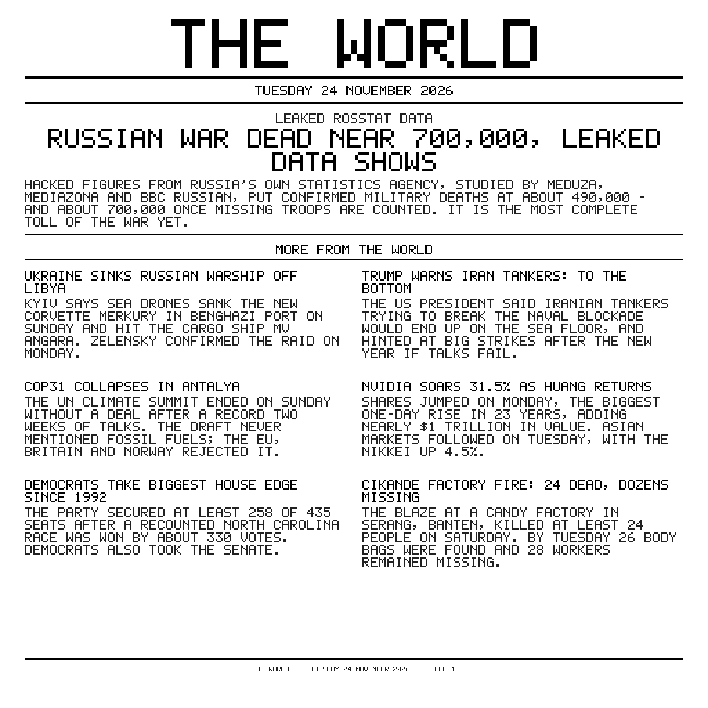

# The World — Tuesday 24 November 2026

[](https://make.fun/competitions/news-image-20261124)
[](LICENSE)
[](main.py)

One-page newspaper front page summing up the world's news on Tuesday
24 November 2026, drawn entirely with the Python standard library.

Lead story: leaked Russian statistics-agency data puts the war dead at
near 700,000. Also inside: Ukraine sinks a Russian warship off Libya,
Trump's warning to Iranian tankers, the COP31 collapse in Antalya,
Nvidia's 31.5% surge, the Democrats' biggest House edge since 1992,
and the Cikande factory fire.

## Run

```sh
python3 main.py   # writes entry.png (1024x1024, deterministic)
```

No third-party packages: the page is rendered with a hand-drawn 5x7
bitmap font and the PNG is encoded with `struct` + `zlib` only.

## Entry



Competition: [news-image-20261124 on make.fun](https://make.fun/competitions/news-image-20261124)
